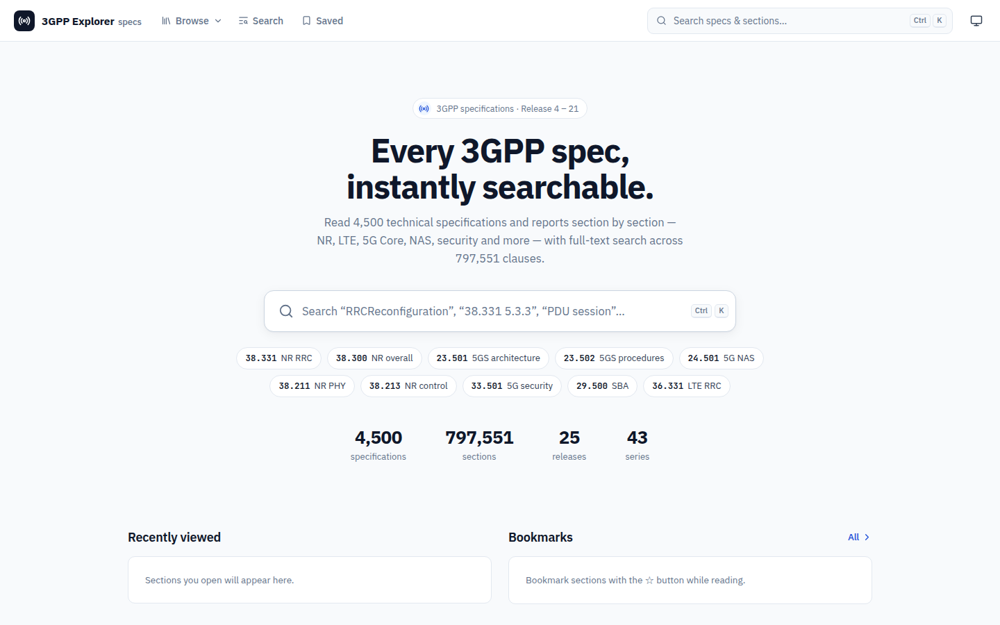
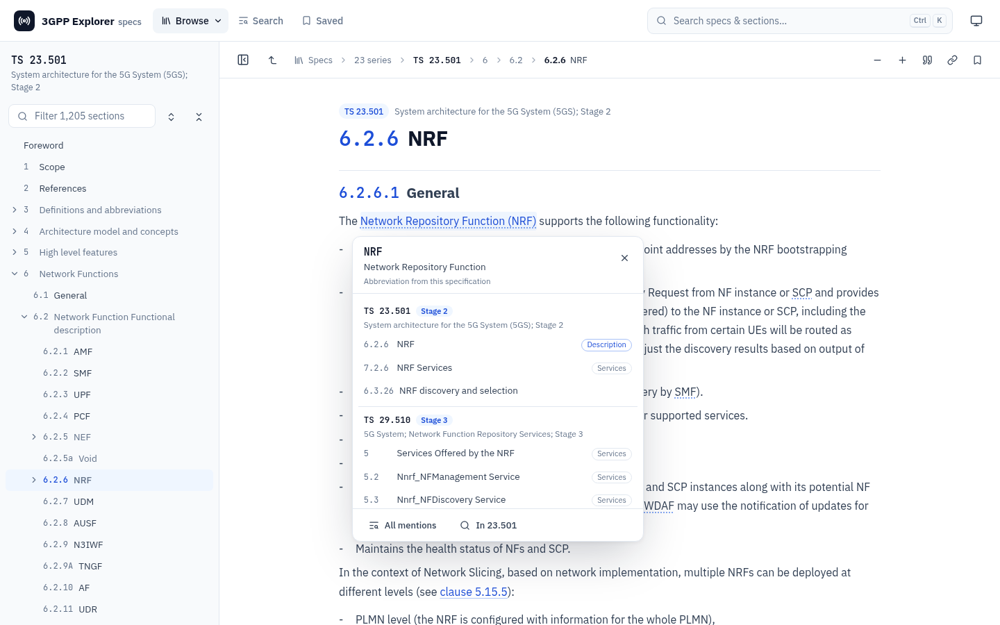
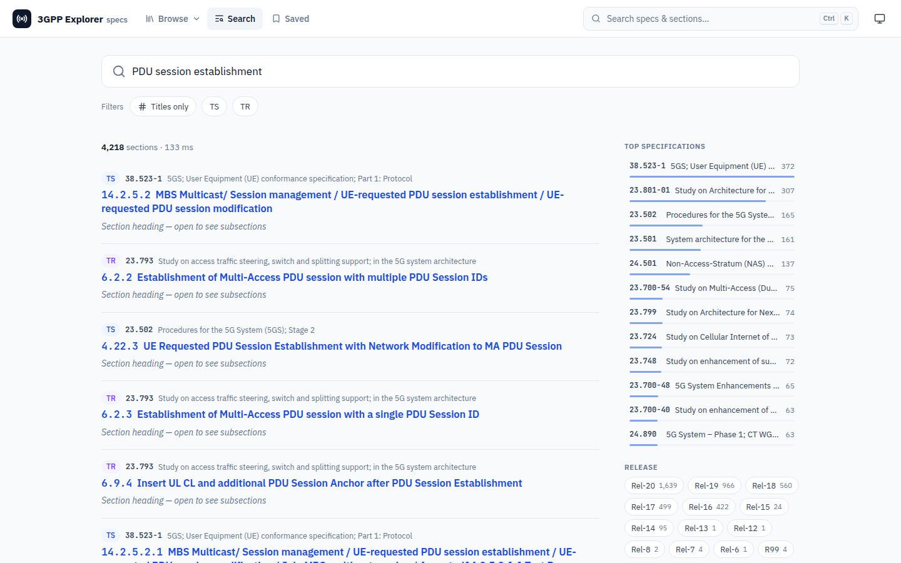
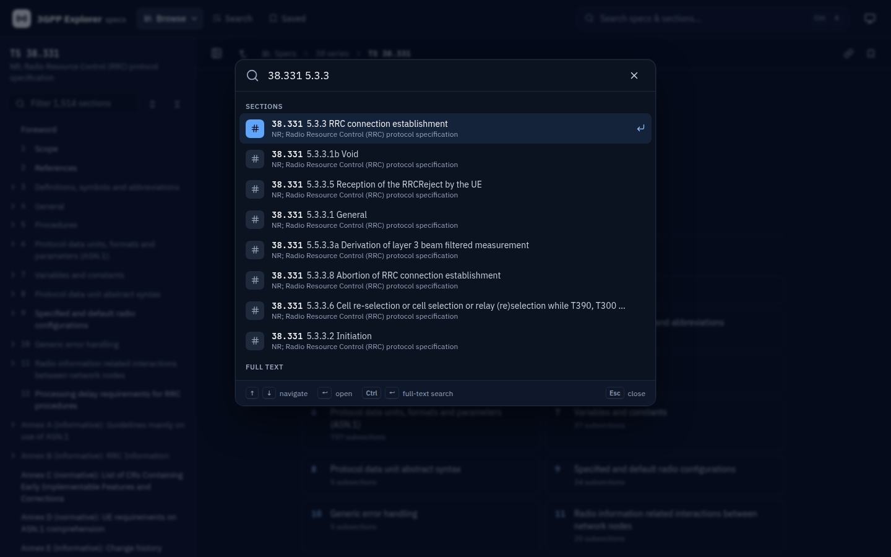
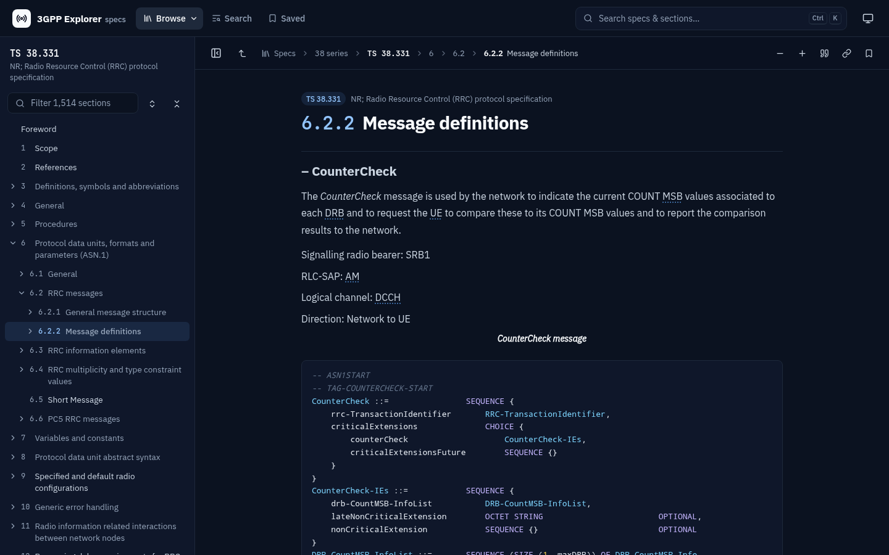
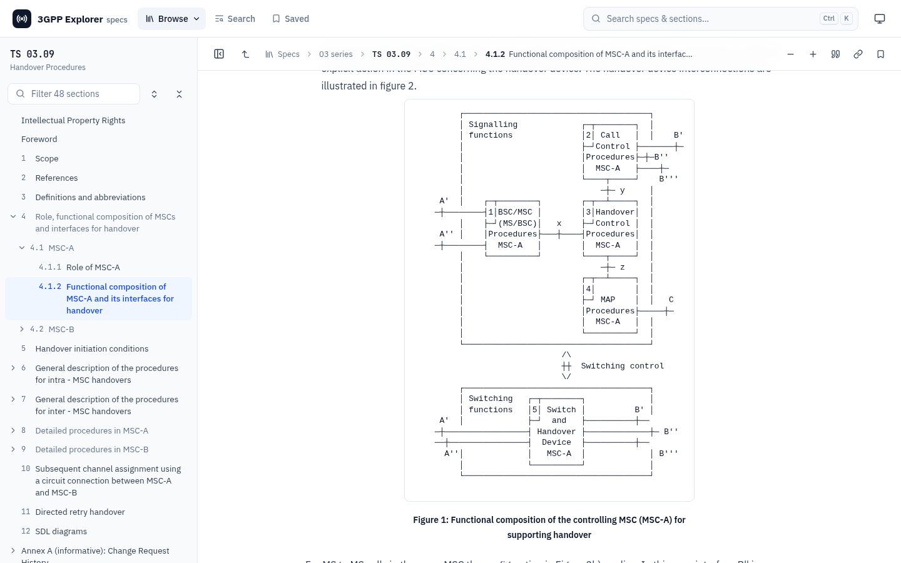
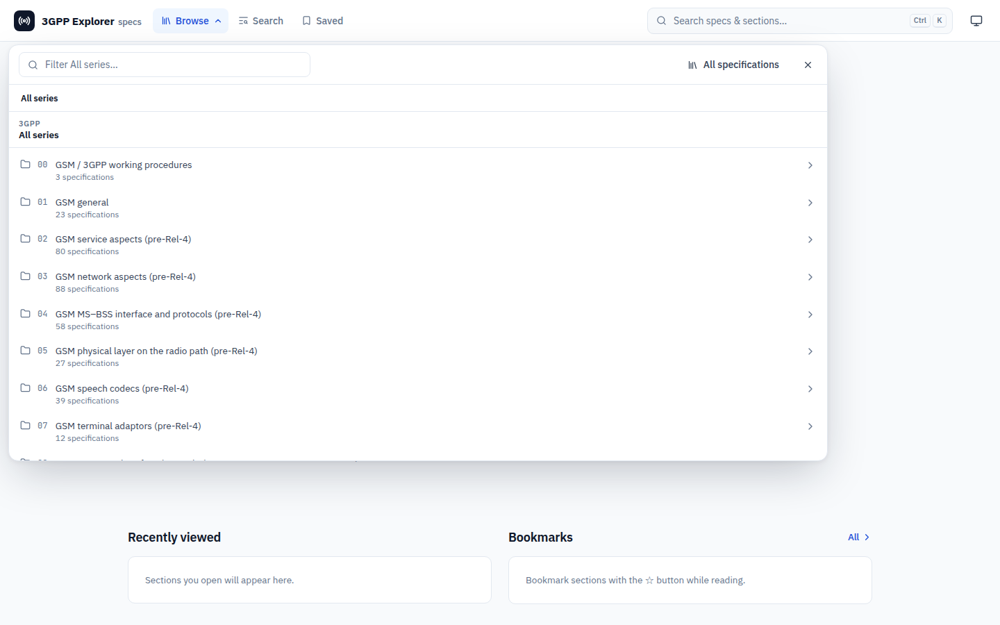

<p align="center">
  
</p>

<h1 align="center">3GPP Spec Explorer</h1>

<p align="center">
  <b>Every 3GPP specification, instantly searchable.</b><br>
  A fast reader and full-text search engine for all 4,500 3GPP TS/TR numbers, from GSM phase 1 to Rel-21,
  packaged as one drop-in web component and a zero-dependency Node server.
</p>

<p align="center">
  <a href="https://github.com/paulmataruso/3gpp-spec-explorer/actions/workflows/ci.yml"></a>
  <a href="LICENSE"></a>
  
  
  
</p>

<p align="center">
  <a href="#quick-start">Quick start</a> ·
  <a href="docs/README.md">Documentation</a> ·
  <a href="docs/embedding.md">Embedding</a> ·
  <a href="docs/api.md">HTTP API</a> ·
  <a href="docs/coverage.md">Coverage</a>
</p>



## Why

3GPP specifications are the reference for building anything in mobile networks. They are published as
thousands of Word files in zip archives, spread across versions and releases. 3GPP Spec Explorer turns
the whole set into one reader you can search, link to and embed:

- every TS and TR, every clause down to the last sub-subsection;
- tables, ASN.1, OpenAPI YAML, equations and figures;
- the GSM-era diagrams that other converters scramble.

```html
<script type="module" src="https://your-host/embed.js"></script>
<spec-explorer></spec-explorer>
```

## Features

<table>
  <tr>
    <td width="50%"></td>
    <td width="50%"></td>
  </tr>
  <tr>
    <td><b>Concept links.</b> The first mention of every abbreviation and service name (AUSF, Nnrf,
      Nnrf_NFManagement_NFRegister) opens a card. It shows the expansion and where the term is described:
      stage 2 (TS 23.501), procedures (TS 23.502) and the stage 3 API (TS 29.5xx).</td>
    <td><b>Full-text search</b> over 797,551 sections in a fraction of a second. SQLite FTS5 with BM25, phrases,
      exclusions, prefixes, <code>spec:</code> <code>series:</code> <code>rel:</code> <code>type:</code>
      filters, facets and highlighted snippets.</td>
  </tr>
  <tr>
    <td></td>
    <td></td>
  </tr>
  <tr>
    <td><b>Command palette</b> (<kbd>Ctrl/⌘</kbd> <kbd>K</kbd> or <kbd>/</kbd>). Type
      <code>38.331 5.3.3</code> or <code>TS 23.501 §5.6</code> to jump straight to a clause.</td>
    <td><b>Built for engineers</b>: ASN.1 highlighting, OpenAPI YAML you can copy or download, KaTeX
      math, zoomable figures, citations ("3GPP TS 38.331 V19.2.0, clause 5.3.3"), "cited by" lists,
      bookmarks and history.</td>
  </tr>
  <tr>
    <td></td>
    <td></td>
  </tr>
  <tr>
    <td><b>Nothing left out.</b> GSM-era box drawings, Symbol-font characters, figures hidden in tracked
      changes, and test suites shipped beside the document are all recovered. See
      <a href="docs/coverage.md">Coverage</a>.</td>
    <td><b>Drill-down navigation</b> from series to spec to chapter to the last subsection, with breadcrumbs
      all the way back, a filterable TOC tree, and prev/next with <kbd>[</kbd> <kbd>]</kbd>.</td>
  </tr>
</table>

**Embeddable anywhere.** The widget works in any page:

- Its styles live in a Shadow DOM, isolated from the host page.
- It has three routing modes (hash, history, memory).
- Every colour and font is a CSS variable you can theme.
- It supports light, dark and auto themes.
- Container queries let it fit anything from a 390 px phone column to a wide desktop pane.
- The bundle is about 57 KB gzipped.

**Runs on anything with Node ≥ 22.13.** The server has no native modules and no runtime npm
dependencies (it uses the built-in `node:sqlite`). Docker is optional.

## Quick start

```bash
git clone https://github.com/paulmataruso/3gpp-spec-explorer.git
cd 3gpp-spec-explorer
npm ci
npm run build            # dist/web (embed.js) + dist/server
# data/3gpp.db + data/images/ must exist → see "The data" below
npm start                # http://localhost:8080
```

Or with Docker:

```bash
docker compose up --build    # serves ./data read-only on http://localhost:8080
```

[Getting started](docs/getting-started.md) shows how to build a small database with two specs in a few
minutes.

## Embed it in your site

```html
<script type="module" src="/3gpp/embed.js"></script>
<spec-explorer api="/3gpp/api" routing="memory" start="spec/23.501/5.6" theme="auto"
               style="height: 100vh"></spec-explorer>
```

```js
const el = document.querySelector('spec-explorer');
el.navigate('spec/38.331/5.3.3');
el.addEventListener('se-navigate', (e) => console.log(e.detail));
```

Mount the API inside an existing Node app (Express, Fastify, Koa or plain `http`):

```js
import { createHandler } from './dist/server/index.js';
app.use(createHandler({ dbPath: '/srv/3gpp/3gpp.db', imagesDir: '/srv/3gpp/images', basePath: '/3gpp' }));
```

More in [Embedding](docs/embedding.md) and [Running the server](docs/server.md).

## The data

The repository contains **code only**. A resumable pipeline builds the data
([Building the data](docs/data-pipeline.md)) from two sources:

- [itecspec.com/3gpp](https://itecspec.com/3gpp), for the section text and structure;
- the official [3GPP archive](https://www.3gpp.org/ftp/Specs/), for figures, the documents
  itecspec lacks, newer versions, and every section itecspec renders incompletely.

| | |
|---|---|
| Spec numbers | 4,500 (4,165 with a published document) |
| Sections | 797,551 |
| Figures | 186,442 |
| Specs newer than itecspec | 599 |
| Sections completed from the official `.docx` | 3,346 |
| Files recovered from the spec zips | 45,778 (TTCN-3 suites, codecs, ASN.1/YANG/XSD, spreadsheets) |

The [coverage report](docs/coverage.md) lists what was filled in, and the few things no source has.

## Documentation

| | |
|---|---|
| [Getting started](docs/getting-started.md) | Requirements, install, first run, Docker |
| [Building the data](docs/data-pipeline.md) | Crawl, conversions, figures, database: every step and option |
| [Coverage](docs/coverage.md) | What's in the database, and what no source has |
| [Embedding the widget](docs/embedding.md) | Attributes, routing, methods, events, theming, frameworks |
| [Running the server](docs/server.md) | Configuration, Docker, reverse proxies, mounting in your app |
| [HTTP API](docs/api.md) | Endpoints with example responses, search syntax |
| [Architecture](docs/architecture.md) | Layout, rendering, database schema, search |
| [Development](docs/development.md) | Dev loop, testing changes, conventions, CI |

## Legal

The code is released under the [MIT license](LICENSE).

The 3GPP specifications are © 3GPP Organizational Partners (ARIB, ATIS, CCSA, ETSI, TSDSI, TTA, TTC).
They are not part of this repository; the pipeline downloads them from their public sources. Check 3GPP's
terms before you redistribute a built database. The crawler fetches only page payloads from itecspec.com,
and stays out of the paths its `robots.txt` disallows.

This project is not affiliated with or endorsed by 3GPP, ETSI or itecspec.
