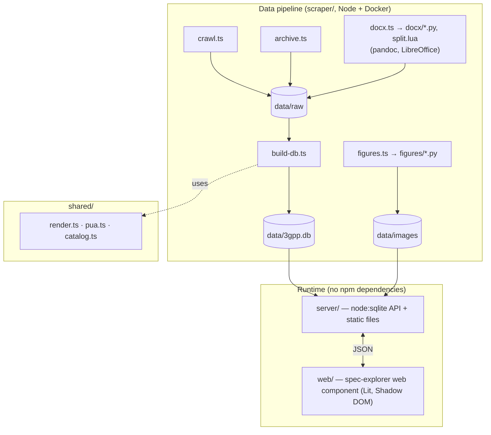

# Architecture



All rendering happens **at build time**. Sections are stored as finished, Brotli-compressed HTML, so
the server only looks rows up, decompresses them, and sends them. Search is SQLite FTS5.

## Project layout

```
scraper/                 data pipeline (TypeScript run natively by Node ≥ 22)
  crawl.ts                 itecspec catalog, TOCs, versions, section content (resumable)
  rsc.ts                   parser for React Server Components payloads
  extract.ts               payload → TOC / sections / archive versions
  archive.ts               specs only the 3GPP archive has; --latest: newest document of every spec
  docx.ts                  specs from the official .docx (all conversion modes)
  docx/
    convert_docx.py          prepares a .docx for pandoc (symbols, drawings, tracked changes, Strict OOXML)
    split.lua                pandoc filter: cuts the document into sections, code blocks, LD drawings
    legacy.py                Word 2/6/95/97, RTF, WordPerfect, PDF-only zips; picks a zip's spec parts
    chardraw.py              box/ASCII character drawings and Symbol/Wingdings characters
    drawings.py              Word shape drawings (charts, canvases, groups) rendered to pictures
    attachments.py           files beside the document in a zip
    attachdocs.py            Word / spreadsheet / Visio attachments rendered for reading
    bandcombos.py            38.101 band-combination JSON rendered back into clauses
    inflate64.py             Deflate64 zip members
  figures.ts               figures from the official zips
  figures/                 EMF/WMF rendering (LibreOffice UNO + ImageMagick)
  build-db.ts              the SQLite database
  fill-check.ts            which sections the completeness fill would replace
shared/
  render.ts                itecspec node trees and pandoc HTML → clean semantic HTML + plain text, KaTeX
  pua.ts                   U+F0xx private-use characters → the character the font draws
  catalog.ts               series names, releases, title helpers
server/
  server.ts                standalone entry point (env configuration)
  index.ts                 createHandler() for embedding in other Node apps
  api.ts                   routing, compression, ETags, static files, SPA fallback
  db.ts                    prepared statements over node:sqlite
  search.ts                query parser → FTS5 MATCH, ranking, snippets, facets, suggestions
  terms.ts                 term lookup: abbreviations, NFs, services, operations → describing sections
web/
  src/embed.ts             registers <spec-explorer>
  src/app.ts               the shell: header, routing, theme, palette
  src/views/               home, browse, search, reader, saved
  src/components/          navmenu (drill-down), palette (Ctrl/⌘ K), toc (filterable tree)
  src/lib/                 api client, router (hash/history/memory), store, term links
  src/styles/              design tokens, content typography, KaTeX
  static/                  standalone index.html, embed-example.html, favicon
docker/
  converter/               LibreOffice 7.4, pandoc, ImageMagick
  legacy/                  current LibreOffice, wvWare, poppler, tesseract
  entrypoint.sh            app container: first-start data download, then the server as "node"
scripts/
  fetch-data.mjs           downloads + verifies + unpacks the data release named in data-bundle.json
  publish-data.mjs         packs data/ into that release (GitHub) and writes data-bundle.json
  finish.sh, complete.sh   the unattended pipeline
  crawl-bg.sh, server-bg.sh, build-server.mjs
Dockerfile, docker-compose.yml   `docker compose build && docker compose up -d`
data-bundle.json         the data release this version of the code uses
```

## Rendering

The two kinds of source go through `shared/render.ts` and produce the same kind of HTML:

- **Crawled sections** arrive as itecspec's component trees (`CNode`), which `renderSection()` turns into
  semantic HTML and plain text. References to specs and clauses become
  `<a class="xref" data-spec="23.502" data-sec="4.3.2">`, which the widget turns into routes for its
  current routing mode. ASN.1 blocks become `pre.asn1`, and equations are rendered with KaTeX.
- **Converted sections** arrive as pandoc HTML cut by `split.lua`. `finishDocxHtml()` applies the same
  cleanup, links and KaTeX.

Both then pass through `fixPuaHtml()` (`shared/pua.ts`). It maps Symbol/Wingdings/line-draw
private-use characters by context, and turns code page 437 box drawings into `pre.ld` blocks.

## Database

```sql
CREATE TABLE meta(key TEXT PRIMARY KEY, value TEXT);          -- build info shown by /api/info

CREATE TABLE specs(
  spec TEXT PRIMARY KEY,          -- "23.501", "04.08dcs", "00.01U"
  title TEXT NOT NULL, short_title TEXT NOT NULL,
  tsg TEXT, type TEXT NOT NULL,   -- TS | TR
  release TEXT NOT NULL, rel_num INTEGER NOT NULL, series TEXT NOT NULL,
  section_count INTEGER NOT NULL, available INTEGER NOT NULL,
  latest_version TEXT, latest_date TEXT,
  toc BLOB,                       -- Brotli JSON: [id, number, title, depth] rows
  versions TEXT,                  -- JSON: full version history with archive URLs
  status TEXT,                    -- 3GPP portal status for archive-only specs
  source TEXT                     -- itecspec | archive
);

CREATE TABLE sections(
  id INTEGER PRIMARY KEY,
  spec TEXT NOT NULL, sid TEXT NOT NULL, num TEXT, title TEXT NOT NULL,
  ord INTEGER NOT NULL, depth INTEGER NOT NULL, parent TEXT, child_count INTEGER NOT NULL,
  chars INTEGER NOT NULL,
  html BLOB,                      -- Brotli-compressed finished HTML
  text BLOB                       -- Brotli-compressed plain text (snippets)
);

CREATE TABLE abbrevs(spec TEXT NOT NULL, abbr TEXT NOT NULL, expansion TEXT NOT NULL);
CREATE TABLE refs(to_id INTEGER NOT NULL, from_id INTEGER NOT NULL,      -- "cited by" graph
                  PRIMARY KEY(to_id, from_id)) WITHOUT ROWID;

CREATE VIRTUAL TABLE fts USING fts5(
  title, body, spec, series, rel, type, kind,
  content='', contentless_delete=1,
  tokenize="unicode61 remove_diacritics 2 tokenchars '_'",
  prefix='2 3 4'
);
```

Indexes: `sections(spec, ord)`, unique `sections(spec, sid)`, `sections(spec, parent)`,
`specs(series)`, `specs(rel_num)`, `abbrevs(abbr)`, `abbrevs(spec)`.

The FTS index is *contentless*, so it stores only the index and the text lives once, in `sections.text`.
`tokenchars '_'` keeps identifiers such as `Nnrf_NFManagement_NFRegister` whole. Results are ranked with
`bm25(fts, 6.0, 1.0, …)`, so a match in a title counts six times as much as one in the body. Snippets
are cut from the decompressed `text` of the hits on the current page only.

## Server

`server/api.ts` is one function, `route(req, res)`, over a plain `node:http` request:

- It matches the `BASE_PATH`.
- It answers `/api/*` from prepared statements.
- It serves figures and the widget bundle, with in-memory caching and immutable hashed assets.
- It falls back to `index.html` for HTML navigations.

JSON is compressed with Brotli or gzip, depending on what the client accepts, and carries an ETag. The
database is opened read-only and reopened when the file changes.

## Web component

`<spec-explorer>` is a Lit element with its own Shadow DOM:

- **Theming.** All styling comes from CSS custom properties (`--se-*`), which a host page can override.
- **Layout.** Container queries adapt it to the element's width.
- **Routing.** The router has three modes (hash, history, memory), so the widget can coexist with any
  host router.
- **Local data.** Preferences, bookmarks and reading history live in `localStorage` under
  `spec-explorer:*`, with every access guarded.
- **Concept links.** The reader marks the first mention of each abbreviation or service name in a section
  (`button.term`). Clicking one opens a card from `/api/term`.
