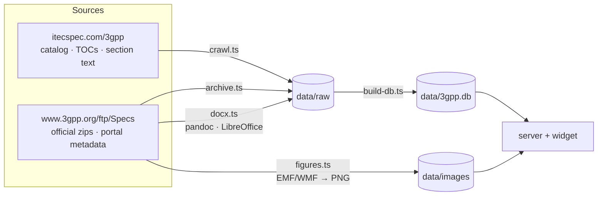

# Building the data

The pipeline turns two sources into the two things the server needs, `data/3gpp.db` and `data/images/`.
Everything it produces lives under `data/`, which git ignores. **Every step is resumable**: rerunning a step
skips the work that is already done, so an interrupted run only has to be started again.



## Sources

- **itecspec.com/3gpp** gives the catalog, each spec's table of contents and the section text, as React
  Server Components payloads. The crawler fetches only page payloads. It stays out of the paths that
  `robots.txt` disallows (`/api/`, `/search`).
- The **official 3GPP archive** (`https://www.3gpp.org/ftp/Specs/archive/` and `latest-drafts/`) provides
  everything else:
  - the figures;
  - the very large conformance specs;
  - the ~1,000 specs itecspec does not publish;
  - newer versions than itecspec's;
  - sections itecspec renders incompletely;
  - the files that ship beside the document in each zip.

  Spec status, titles and working groups come from the 3GPP portal.

## Converter images

The document conversions run in two Docker images:

```bash
docker build -t spec-explorer-converter:1 docker/converter   # LibreOffice 7.4 (Writer, Draw, Calc), pandoc, ImageMagick, python3-uno
docker build -t spec-explorer-legacy:1    docker/legacy      # current LibreOffice, wvWare, poppler, tesseract OCR
```

`CONVERTER_IMAGE` and `LEGACY_IMAGE` override the image names.

## The steps

| # | Command | Produces |
|---|---|---|
| 1 | `npm run crawl -- catalog` then `npm run crawl -- specs` | Spec list, every spec's TOC and version history with archive URLs |
| 2 | `scripts/crawl-bg.sh start sections --max-sections 3000 --concurrency 12 --spec-parallel 6` | Section content for every spec with ≤ 3000 sections (detached; `status` / `stop`, log in `data/crawl.log`) |
| 2b | `node scraper/archive.ts` | Specs only the archive has, with their versions and portal records |
| 3 | `npm run docx` | Huge specs and specs whose itecspec TOC repeats ids, from the official `.docx` |
| 3b | `npm run docx -- --openapi` | Specs carrying OpenAPI YAML, rebuilt so the YAML keeps its exact indentation |
| 3c | `npm run docx -- --archive` | Text of the archive-only specs |
| 3d | `node scraper/archive.ts --latest` then `npm run docx -- --latest` | Specs where the archive is newer than itecspec |
| 3e | `npm run docx -- --redo` | Re-conversions after converter fixes |
| 3f | `npm run docx -- --fill` | Every crawled spec again from its `.docx`, to complete sections itecspec renders incompletely |
| 3g | `npm run docx -- --attachments` | The files that ship beside the document in each zip |
| 4 | `npm run figures` | Figures from the official zips, EMF/WMF rendered to sharp 2× PNGs |
| 5 | `npm run build:db` | `data/3gpp.db` (about 15 minutes) |

### Running it unattended

Two scripts chain the steps and wait for each other through pidfiles:

```bash
# wait for the crawl → retry pass → archive-only specs → .docx conversions → figures → database
setsid sh -c 'echo $$ > data/finish.pid; exec scripts/finish.sh' > data/finish.log 2>&1 < /dev/null &

# afterwards: leftovers → re-conversions → newer versions → completeness fill → figures → database
setsid sh -c 'echo $$ > data/complete.pid; exec scripts/complete.sh' > data/complete.log 2>&1 < /dev/null &
```

The crawl is I/O-bound by the origin: about 24 requests/s, roughly 5–6 hours for all sections. The
finished `data/3gpp.db` + `data/images/` can be copied to any machine.

## Step details

### 1–2. Crawl

`scraper/crawl.ts` reads itecspec's RSC payloads (`scraper/rsc.ts` parses them, `scraper/extract.ts`
turns them into TOCs, sections and archive versions). Options: `--only 38.331,38.300`, `--limit 50`,
`--concurrency 6`, `--max-sections`, `--spec-parallel`. `DATA_DIR` moves the data folder.

Specs with more than 3,000 sections (about 11 conformance specs such as 34.123-1, 36.521-1 and
51.010-1) are left to step 3.

### 2b. Archive-only specs

`scraper/archive.ts` lists every spec folder of the official archive (4,205). It records in
`data/raw/catalog-archive.json` the ~1,000 specs that itecspec does not publish, with their versions and
their 3GPP portal record (title, TS/TR, status, working group):

- GSM phase 1/2 specs (series 01–12);
- early UMTS "xx.yyU" documents;
- withdrawn specs.

The file is kept apart from the crawl, so a re-crawl cannot overwrite it.

It also lists:

- **42 empty archive folders**: numbers that were allocated but never published.
- **293 portal-only numbers**: numbers the portal's per-series reports register without any archive
  folder, saved in `data/raw/portal-index.json`:
  - 248 were withdrawn before change control;
  - 32 are drafts with nothing uploaded;
  - 13 were withdrawn under change control, and 3GPP no longer hosts their documents. Its dated snapshot
    folders are emptied, and ETSI has no copy.

These numbers appear in the browser as "no document published".

### 3. Huge specs and duplicate-id TOCs

`scraper/docx.ts` converts a spec from its official `.docx` with pandoc. `scraper/docx/convert_docx.py`
prepares the document and `scraper/docx/split.lua` cuts it into sections. In this mode, the document's own
headings become the TOC.

It is used for three groups:

- specs with more than 3,000 sections;
- specs itecspec has no TOC for (34.122);
- the ~440 specs whose itecspec TOC repeats ids. itecspec can serve only the first "Initial conditions"
  of 34.123-1, or the first letter group of 21.905.

Unnumbered sub-headings get ids such as `6.1.3.1--system-simulator`.

### 3b. OpenAPI specs

Specs whose text carries OpenAPI definitions (29.5xx, 29.122, 24.5xx, 26.5xx, …) are rebuilt from the
`.docx`, so the YAML keeps its exact indentation. In the reader you can copy the YAML or download it as
`TSxxxxx_<API>.yaml`. The crawled version is kept in `data/raw/sections-crawled/`.

### 3c. Archive-only text: legacy formats

Each spec from 2b is converted from its newest version that is a real document. A final "withdrawn" stub
upload is skipped. How each format is handled:

- **Word 2/6/95/97 `.doc`, `.rtf` and WordPerfect** go through a current LibreOffice (`docker/legacy`).
  The few Word files LibreOffice hangs on (51.010-2) go through wvWare instead. Its HTML keeps the
  paragraph style names, so headings, tables and figures survive.
- **PDF-only zips** (some 1990s GSM specs) go through `pdftotext`. Scans with no text layer go through
  tesseract OCR.
- **A zip with only a `.txt` note** gives that note (45.014: "consult 05.14").
- **GSM-era documents without heading styles** have their headings found from the clause numbers. The
  pipeline takes the best-scoring chain of numbers that follow on, so that the list of contents and
  numbered table rows are not mistaken for headings.

**Choosing the parts.** Of the documents in a zip, only the spec's own are converted (`spec_parts` in
`scraper/docx/legacy.py`, used by every mode). The following are left out, because each of them once
doubled or polluted the text:

- revision-marked twins of the clean document (`_cl`/`_rm`, `clean`/`changemarks`, `ChangeBars`);
- `_track_changes` copies;
- plenary cover notes (`SP-070302.docx`);
- macOS `._` files and attachment folders;
- a document with the spec's number but another version (`24067-i00.docx` inside `24067-j00.zip`).

A few layouts get special handling:

- A `.doc` next to `.docx` parts is converted as a part of its own. 36.889's body is `.doc` and its annexes
  `.docx`.
- When the documents next to an inner zip are only TDocs, the inner zip is the spec.
- Parts are recognised by content, not by name. `36714-00-00-e00.doc` is a Word 2007 file, so it is read
  as `.docx`.

**itecspec TOCs missing whole clauses.** For 23.748 (clause 6 "Solutions" has no sub-clauses there,
512K characters missing), 23.783, 38.858, 36.881 and 36.579-3, the spec is converted from the document
with its own headings (`tocSource: "docx"`).

### 3d. Newer than itecspec

itecspec lags the archive. For 23.501, it has v20.1.0 while the archive has v20.3.0, and about 600 specs
are one or more versions behind. itecspec also lists only part of each spec's version history.

`archive.ts --latest` lists every crawled spec's archive folder (plus `Specs/latest-drafts/`) into
`data/raw/archive-latest.json`. Specs that have a newer document are then converted from it. The database
shows the full version history and which version the text comes from.

**Band combinations.** From Rel-20, 38.101-1/-2/-3 keep their CA/DC configuration tables beside the
document, in `Band Combinations.zip` (one JSON file per configuration).

- `scraper/docx/bandcombos.py` renders them back into the clauses that point at them.
- The layout follows 3GPP's own renderings.
- Each configuration goes to the clause whose title fits it: CA/EN-DC/NE-DC/NR-DC, intra/inter-band, FR1/FR2.
- Checked against Rel-19, where the tables were still in the document, 99.9% land in the same clause.

### 3e. Re-conversions

`--redo` reconverts these specs:

- specs whose last conversion had a part pandoc could not read;
- specs whose last conversion produced at most 3 sections;
- every spec listed in `data/redo.txt`, one per line. An entry is removed once it converts.

Use `--dry` with any mode to see what it would convert.

### 3f. Completeness fill

Every crawled spec is converted once more from its `.docx`. The result is cut along itecspec's own
section ids into `data/raw/sections-docx/`. The database build then takes a section from there when the
official text is clearly longer, or carries figures that itecspec left out. Most often these are tables
and figures nested inside table cells, which itecspec drops; they are common in TR solution clauses.

The fill is not applied in these cases:

- **The two versions disagree overall.** They are compared only over the sections where itecspec has
  text, so its empty placeholders can still be filled.
- **The `.docx` section does not end where itecspec's does.** Its text would show twice.

Converter fixes that matter for completeness, all in `scraper/docx/`:

| Problem in the source | Fix |
|---|---|
| Message sequences drawn with characters (style LD: 04.08, 23.082, 44.056). itecspec collapses their spaces. | Rendered as `<pre class="ld">` with each line where Word centres it |
| GSM-era box/ASCII drawings without style LD (`┌──┐`, `+---+`, `---->`: 04.08's message tables, 07.01, 09.10, 09.11) | `chardraw.py` marks them LD, expands tabs to Word's tab stops and keeps their indentation |
| Symbol, Wingdings and line-draw fonts store characters at U+F020–U+F0FF, so they render as blank boxes | Mapped to the character the font draws ("T0 ± 148 chips" in 25.214). For itecspec's text, which has no fonts, `shared/pua.ts` decides by context. |
| Charts, drawing canvases and shape groups drawn with Word's own shapes | `drawings.py` renders them with LibreOffice and poppler |
| Embedded objects without a preview picture (23.402's "Word.Picture.8" diagrams) | Rendered from the embedded document |
| pandoc drops pictures inside tracked insertions (`<w:ins>`) | Tracked changes are accepted before pandoc (369 figures in 45 documents) |
| Word's Strict save wraps OLE objects in `mc:AlternateContent` that pandoc cannot read (22.839) | Unwrapped to the object |
| Word-indented code (style PL) is read by pandoc as a block quote, emptying SIP examples (24.247 and 80 other specs) | Kept as code |
| Strict OOXML namespaces, and an unescaped Symbol-font `<`, made pandoc reject the whole part | Namespaces rewritten; character escaped |

**Cutting along itecspec's ids** (in this step and in 3b):

- Numbered headings are matched by number.
- Unnumbered ones (38.331's `– BCCH-BCH-Message` and every IE) are matched when the TOC lists them right
  after the last section matched.
- Titles itecspec could not number (`6.2.1_1.1 Test purpose`, `Annex <X> …`) are matched by its
  title-based id, which it cuts at 80 characters.

`node scraper/fill-check.ts <spec>` shows which sections the fill would replace.

### 3g. Files in the zip

Many zips carry more than the document. For some specs, those files are the specification itself:

- TTCN-3 test suites (36.523-3, 37.579-x);
- codec reference code (26.104, 06.10);
- OSA IDL/WSDL, YANG/YAML models, ASN.1 modules and XML schemas;
- the test tolerance analyses that make up most of 38.903, 38.905 and 36.903.

`scraper/docx/attachments.py` records every file, opening nested zips, in
`data/raw/attachments/<spec>.ndjson.gz`. Each kind of file is handled differently:

| File | How it appears |
|---|---|
| Text files whose content the document does not already carry | Shown as they are |
| Word files | Converted through the specs' own pandoc path |
| Spreadsheets | Tables, via LibreOffice Calc's HTML export. A very large workbook keeps the first rows of each sheet. |
| Visio drawings | Pictures (`attachdocs.py`) |
| Binaries | Listed, with a link to the zip |

Members compressed with Deflate64 (zip method 9, which Python's `zipfile` cannot read) go through
`inflate64.py`. The database adds all of these as a last annex, "Files in the TS zip".

### 4. Figures

`npm run figures` downloads each spec's official zip and extracts the figures. EMF/WMF vector drawings
are rendered to 2× PNGs (`scraper/figures/convert.py`, LibreOffice + ImageMagick). `--retry` also tries
the two previous versions, and, for specs without a link in the metadata, the spec's archive folder.

### 5. Database

`npm run build:db` (`scraper/build-db.ts`) writes `data/3gpp.db`, which holds:

- the specs;
- sections as Brotli-compressed HTML;
- an FTS5 index;
- abbreviations;
- the cross-reference graph.

It builds into a temporary file and renames it at the end, so a running server keeps serving the old
database until then. See [Architecture](architecture.md#database) for the schema.

## Useful options

```bash
npm run crawl -- sections --only 38.331,23.501        # specific specs
npm run figures -- --only 38.300 --retry              # redo figures for one spec
npm run docx -- --only 36.523-1 --force               # reconvert one huge spec
npm run docx -- --fill --only 23.700-83 --force       # redo the fill for one crawled spec
npm run docx -- --latest --dry                        # list what a mode would convert
DB_PATH=/srv/3gpp.db npm run build:db                 # write the database elsewhere
ONLY=04.08,23.501 DB_PATH=/tmp/t.db npm run build:db  # a small database for trying changes
node scraper/fill-check.ts 23.700-83                  # which sections the fill would replace
```

> [!WARNING]
> For a spec whose text comes from the crawl, always use `--fill --only X --force`. A plain
> `--only X --force` converts the spec in heading-discovery mode and replaces the crawled text, which
> moves to `data/raw/sections-crawled/`.

## Sizes

| | |
|---|---|
| `data/` after a complete run | ≈ 15 GB (downloads, raw sections, figures, database) |
| `data/raw/` | ≈ 560 MB (gzipped NDJSON) |
| `data/images/` | ≈ 7 GB, 150,000 files |
| `data/3gpp.db` | ≈ 2.1 GB |

## Publishing the data

`docker compose up` downloads the data from a GitHub release of this repository, named in `data-bundle.json`.
After you rebuild the data, publish it again:

```bash
GITHUB_TOKEN=<token with repo scope> node scripts/publish-data.mjs     # --dry shows the plan, --tag overrides the name
git add data-bundle.json && git commit -m "Data release data-YYYYMMDD" && git push
```

`scripts/publish-data.mjs` builds the release from `data/3gpp.db`, plus only the figures the database
references (resolved like the server resolves them):

| Release file | Contents |
|---|---|
| `3gpp.db.zst.NNN` | the database, zstd-compressed, cut into parts if needed |
| `images.NNN.tar` | the figures, paths relative to `images/` |

How it works:

- **Size limit.** Every file stays under 2 GiB, GitHub's limit for one release file.
- **Disk use.** Files are built, uploaded and deleted one at a time, so about 2 GB of free disk is enough.
- **Resuming.** Rerunning skips files that are already uploaded.
- **Manifest.** It writes `data-bundle.json`, with each file's name, size and SHA-256.

Existing installs pick up the new data after `git pull && docker compose build && docker compose up -d`. The
container sees that `data-bundle.json` names a newer release, and replaces the data it downloaded before. It
never touches data it did not download.

