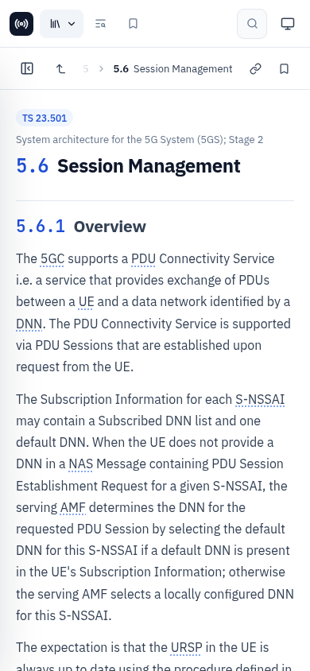

# Embedding the widget

`npm run build` produces `dist/web/`, a static bundle you can host next to the API (the default) or on a
CDN. It contains:

- `embed.js`, about 57 KB gzipped, Lit included;
- `fonts/`;
- a standalone `index.html`.

```html
<script type="module" src="/3gpp/embed.js"></script>

<spec-explorer
  api="/3gpp/api"
  routing="hash"
  theme="auto"
  style="height: 100vh"
></spec-explorer>
```

The element fills its box. Give it a height, or place it in a flex or grid cell. Its styles live in a
Shadow DOM, so the host page's CSS cannot break it and its CSS cannot leak out. The layout uses container
queries, so it adapts to the width of the element, not the window: 390 px phone columns and wide desktop
panes both work.

<p align="center"></p>

## Attributes

| Attribute | Default | Description |
|---|---|---|
| `api` | `<embed.js dir>/api` | API base URL. If the API runs on another origin, allow it with `CORS_ORIGIN`. |
| `routing` | `hash` | One of the [routing modes](#routing-modes) below |
| `base` | `/` | Path prefix for `history` routing |
| `start` | | Initial route for `memory` routing, e.g. `spec/38.331/5.3.3` or `browse?series=38` |
| `theme` | `auto` | `auto`, `light` or `dark`. Overrides the user's toggle. |
| `no-shortcuts` | off | Turns off the global `Ctrl/⌘ K` and `/` shortcuts, for host apps that use them |
| `manage-title` | off | Keeps `document.title` in sync, for standalone pages |
| `hide-header` | off | Hides the top bar, when the host app provides its own navigation |

### Routing modes

| Mode | URL | Use it when |
|---|---|---|
| `hash` | `…/page#/spec/38.331/5.3.3` | Default. Never conflicts with the host app's router. |
| `history` | `/base/spec/38.331/5.3.3` | The widget is the page. The server must fall back to `index.html`; the bundled server does. |
| `memory` | unchanged | The widget lives inside another app (a modal, a side panel) that owns the URL |

Routes: `''` (home), `browse?series=38&rel=19`, `search?q=…`, `spec/<spec>`, `spec/<spec>/<section>`,
`saved`.

## Methods and events

```js
const el = document.querySelector('spec-explorer');

el.navigate('spec/23.501/5.6');      // go to a route
el.openSearch('PDU session');        // open the command palette with a query

el.addEventListener('se-navigate', (e) => {
  console.log(e.detail);             // { path, name, spec?, sid? }
});
```

## Theming

All colours, fonts and radii are CSS custom properties. You can set them on the element from the host
page:

```css
spec-explorer {
  --se-accent: #0d9488;
  --se-accent-hover: #0f766e;
  --se-accent-soft: #f0fdfa;
  --se-accent-text: #0f766e;
  --se-font: 'Inter', system-ui, sans-serif;
  --se-radius: 10px;
  --se-content-size: 17px;
}
```

Available properties:

| Group | Properties |
|---|---|
| Surfaces | `--se-bg` `--se-surface` `--se-surface-2` `--se-surface-3` `--se-border` `--se-border-strong` |
| Text | `--se-text` `--se-text-2` `--se-muted` |
| Accent | `--se-accent` `--se-accent-hover` `--se-accent-soft` `--se-accent-text` `--se-on-accent` |
| TR badge | `--se-tr` `--se-tr-soft` |
| Highlights | `--se-mark` `--se-mark-text` `--se-code-bg` |
| Type and shape | `--se-font` `--se-mono` `--se-radius` `--se-content-size` |

Each colour has a `-dark` twin, e.g. `--se-accent-dark`, which is used in dark mode.

The fonts (IBM Plex Sans, JetBrains Mono, KaTeX) are bundled in `fonts/` and loaded relative to
`embed.js`. To serve them from somewhere else, set `window.SPEC_EXPLORER_FONTS = 'https://cdn.example/fonts/'`
before the script loads.

## Frameworks

It is a standard custom element, so it works in any framework:

```jsx
// React
import '/3gpp/embed.js';
export const Specs = () => (
  <spec-explorer api="/3gpp/api" routing="memory" start="browse" style={{ height: 700 }} />
);
```

```vue
<!-- Vue: add compilerOptions.isCustomElement = (t) => t === 'spec-explorer' -->
<spec-explorer api="/3gpp/api" routing="memory" />
```

```svelte
<!-- Svelte -->
<script>import '/3gpp/embed.js';</script>
<spec-explorer api="/3gpp/api" routing="memory" style="height: 700px" />
```

## Full example

`dist/web/embed-example.html` (source: `web/static/embed-example.html`) is a complete host page. It shows
memory routing, host theming, and host buttons that drive the widget.
